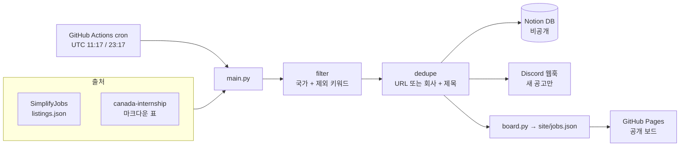
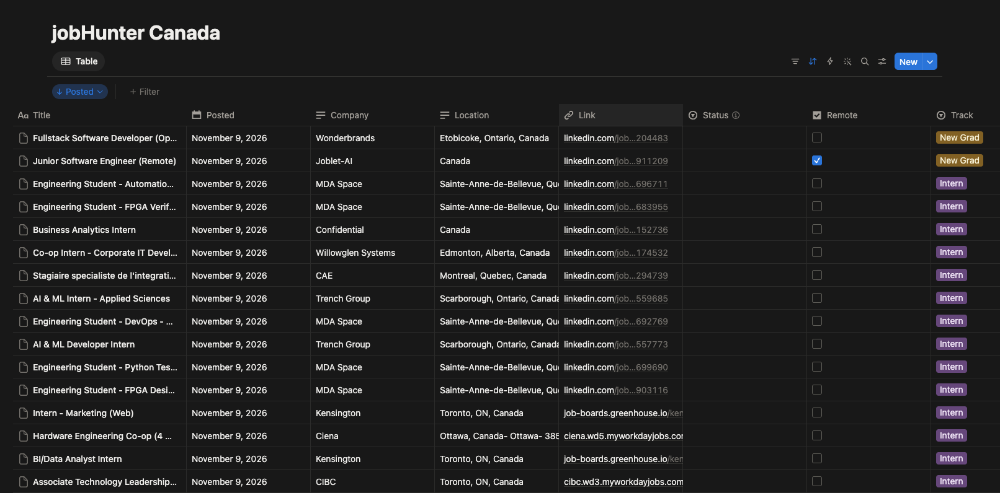

# jobHunter

[English](README.md) | **한국어**

[](https://github.com/AndyChoi4495/jobHunter/actions/workflows/ci.yml)
[](https://github.com/AndyChoi4495/jobHunter/actions/workflows/collect.yml)

캐나다의 소프트웨어 개발자 **인턴 / 코업**과 **신입(New Grad)** 공고를 찾는 개인용 구직 자동화 도구다. 하루 두 번 새 공고를 모아 Notion에 정리하고, Discord로 알림을 보내고, 읽기 전용 공개 공고 보드를 올린다.

**공개 보드:** https://andychoi4495.github.io/jobHunter/

## 왜 만들었나

신입 공고는 금방 마감되고, 일찍 지원할수록 유리하다. 여러 공고 목록을 매일 손으로 확인하는 건 느리고 놓치기 쉽다. jobHunter는 커뮤니티가 관리하는 목록에서 공고를 가져와, 지원할 수 없는 직무를 거르고, 출처 간 중복을 합치고, 어디서 보든 최신 공고가 맨 위에 오게 한다.

## 동작 방식



1. **수집**: 실행마다 출처 목록을 한 번씩 가져온다.
2. **필터**: 지역(국가)과 제목 제외 키워드(senior, manager 등)로 거른다.
3. **중복 병합**: 정규화한 URL, 또는 회사 + 제목이 같으면 합친다.
4. **저장**: 새 공고를 그 지역의 Notion DB에 넣는다. `Job ID` 속성(정규화한 URL)이 중복 판별 키라서 별도 상태 파일이 없다.
5. **알림**: 새 공고 요약을 최신순으로 Discord에 보낸다.
6. **공개**: 보드를 GitHub Pages에 배포한다. 어느 단계든 실패하면 배포를 건너뛰므로, 일부만 모인 보드가 공개 보드를 덮어쓰지 않는다.

### Notion이 UI

새 공고는 Notion DB에 게시일 최신순으로 쌓이고, 여기서 지원 현황을 관리한다.



### 공개와 비공개

보드는 **수집한 공고만으로** 만든다. Notion을 읽지 않으므로 지원 상태, 메모 같은 개인 정보가 새어 나갈 수 없다. 저장소는 공개지만 Notion 워크스페이스는 비공개다.

## 출처

| 출처 | 트랙 | 형식 |
|---|---|---|
| [SimplifyJobs/New-Grad-Positions](https://github.com/SimplifyJobs/New-Grad-Positions) | 신입 | JSON |
| [SimplifyJobs/Summer2027-Internships](https://github.com/SimplifyJobs/Summer2027-Internships) | 인턴 | JSON |
| [Francklin9999/canada-internship](https://github.com/Francklin9999/canada-internship) | 인턴, 신입 (캐나다) | 마크다운 표 |

공고 목록의 공은 이 저장소들을 관리하는 분들에게 있다. 보드는 걸러낸 일부만 보여주고, 모든 공고를 원래 지원 페이지로 연결한다.

## 프로젝트 구조

```
config.yaml              # 출처, 트랙, 제외 키워드, 지역
src/jobhunter/
  main.py                # 한 번의 실행을 조율
  config.py, models.py   # 타입이 있는 config와 Job 모델
  sources/               # 출처마다 모듈 하나
  filter.py, dedupe.py
  notion_store.py        # Notion REST API (requests로 직접 호출)
  notify_discord.py
  board.py               # site/jobs.json 생성 (공개 필드만)
site/                    # 정적 보드: HTML + 순수 JS, 빌드 단계 없음
tests/                   # pytest, 출처별 샘플 데이터 저장
.github/workflows/       # ci.yml (린트 + 테스트), collect.yml (cron + Pages)
```

## 실행 방법

Python 3.9 이상이 필요하다.

```sh
python3 -m venv .venv
.venv/bin/pip install -U pip
.venv/bin/pip install -e '.[dev]'

.venv/bin/ruff check .        # 린트
.venv/bin/pytest              # 테스트 (네트워크 안 씀)
```

**드라이 런.** 실제 출처에서 가져와 `site/jobs.json`을 만들지만 Notion과 Discord는 건너뛴다. 그래서 비밀값이 필요 없다.

```sh
DRY_RUN=1 .venv/bin/python -m jobhunter.main
python3 -m http.server -d site     # http://localhost:8000 에서 보드 확인
```

**실제 실행.** 아래 환경변수(또는 GitHub Actions Secrets)를 설정하고 `DRY_RUN` 없이 실행한다.

| 변수 | 내용 |
|---|---|
| `NOTION_TOKEN` | Notion 내부 통합 시크릿 |
| `NOTION_DB_CANADA` | Notion DB ID (통합과 연결된 DB) |
| `DISCORD_WEBHOOK_CANADA` | Discord 웹훅 URL |

지역은 `config.yaml`에서 설정한다. 지역마다 Notion DB와 Discord 웹훅이 따로 있고, `enabled` / `notify` / `publish` 플래그로 코드 수정 없이 켜고 끌 수 있다.

## 설계 문서

- [`plan.ko.md`](plan.ko.md): 구조와 로드맵
- [`checklist.ko.md`](checklist.ko.md): 진행 상황
- [`context-notes.ko.md`](context-notes.ko.md): 각 결정의 이유

Claude Code와 작은 에이전트 팀(리드 한 명, 파일 담당이 나뉜 팀원 네 명)으로 만들었다. 자세한 구성은 `plan.ko.md`에 있다.
