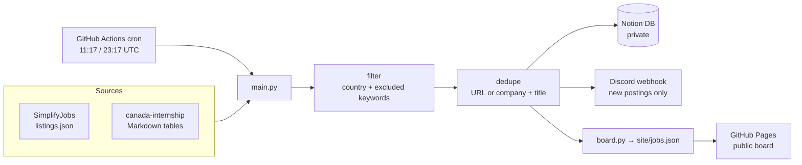
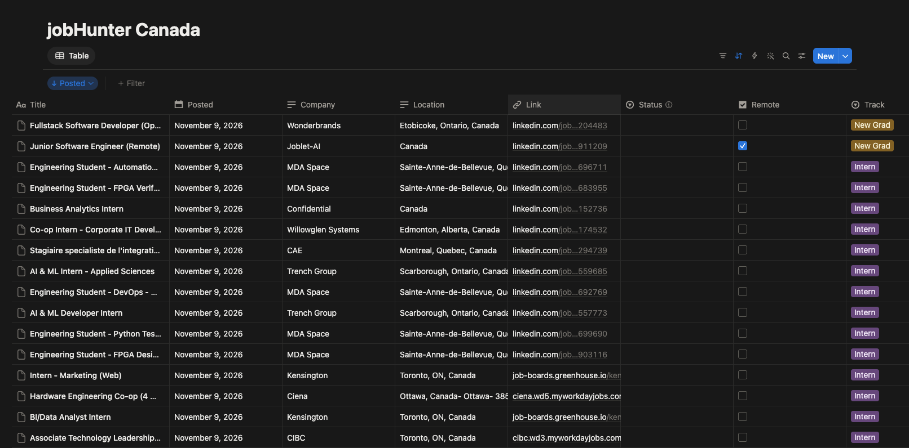

# jobHunter

**English** | [한국어](README.ko.md)

[](https://github.com/AndyChoi4495/jobHunter/actions/workflows/ci.yml)
[](https://github.com/AndyChoi4495/jobHunter/actions/workflows/collect.yml)

A personal job-search automation tool for software developer **intern / co-op** and **new grad** roles in Canada. Twice a day it collects new postings, files them in Notion, pings me on Discord, and publishes a public, read-only job board.

**Live board:** https://andychoi4495.github.io/jobHunter/

## Why

Entry-level postings fill up fast, and applying early matters. Checking several job lists by hand every day is slow and easy to miss. jobHunter pulls from community-maintained lists, filters out roles I can't apply to, removes duplicates across sources, and puts the newest postings first everywhere I look.

## How It Works



1. **Collect** from the source lists once per run.
2. **Filter** by region (country) and excluded title keywords (senior, manager, etc.).
3. **Dedupe** across sources by normalized URL, or by company + title.
4. **Store** new postings in the region's Notion database. The `Job ID` property (the normalized URL) is the dedup key, so there is no separate state file.
5. **Notify** Discord with a summary of new postings, newest first.
6. **Publish** the board to GitHub Pages. If any step fails, the deploy is skipped, so a partial board never replaces the live one.

### Notion as the UI

New postings land in a Notion database, sorted by posted date, where I track what I've applied to.



### Public vs. private

The board is built **only from collected postings**. It never reads Notion, so application status, notes, and anything else personal can't leak into it. The repo is public; the Notion workspace is not.

## Sources

| Source | Track | Format |
|---|---|---|
| [SimplifyJobs/New-Grad-Positions](https://github.com/SimplifyJobs/New-Grad-Positions) | New Grad | JSON |
| [SimplifyJobs/Summer2027-Internships](https://github.com/SimplifyJobs/Summer2027-Internships) | Intern | JSON |
| [Francklin9999/canada-internship](https://github.com/Francklin9999/canada-internship) | Intern, New Grad (Canada) | Markdown tables |
| [JSearch](https://rapidapi.com/letscrape-6bRBa3QguO5/api/jsearch) (weekdays at noon) | By search query | REST API (Notion + Discord only, not on the public board) |

All credit for the listings goes to the maintainers of these repos. The board shows a filtered subset and links every posting to its original application page.

## Project Layout

```
config.yaml              # sources, tracks, excluded keywords, regions
src/jobhunter/
  main.py                # orchestrates one run
  config.py, models.py   # typed config and the Job model
  sources/               # one module per source
  filter.py, dedupe.py
  notion_store.py        # Notion REST API (plain requests)
  notify_discord.py
  board.py               # builds site/jobs.json (public fields only)
site/                    # static board: HTML + vanilla JS, no build step
tests/                   # pytest, with saved sample data per source
.github/workflows/       # ci.yml (lint + tests), collect.yml (cron + Pages)
```

## Running It

Requires Python 3.9+.

```sh
python3 -m venv .venv
.venv/bin/pip install -U pip
.venv/bin/pip install -e '.[dev]'

.venv/bin/ruff check .        # lint
.venv/bin/pytest              # tests (no network)
```

**Dry run.** This fetches the real sources and builds `site/jobs.json`, but skips Notion and Discord, so it needs no secrets.

```sh
DRY_RUN=1 .venv/bin/python -m jobhunter.main
python3 -m http.server -d site     # view the board at http://localhost:8000
```

**Real run.** Set these environment variables (or GitHub Actions secrets), then run without `DRY_RUN`.

| Variable | What |
|---|---|
| `NOTION_TOKEN` | Notion internal integration secret |
| `NOTION_DB_CANADA` | Notion database ID (shared with the integration) |
| `DISCORD_WEBHOOK_CANADA` | Discord webhook URL |

Regions are configured in `config.yaml`. Each region has its own Notion database and Discord webhook, and can be switched on with `enabled` / `notify` / `publish` flags without code changes.

## Design Notes

- [`plan.md`](plan.md): architecture and roadmap
- [`checklist.md`](checklist.md): progress
- [`context-notes.md`](context-notes.md): the reasoning behind each decision

Built with the help of Claude Code, using a small agent team (one lead, four teammates with separate file ownership) as described in `plan.md`.
